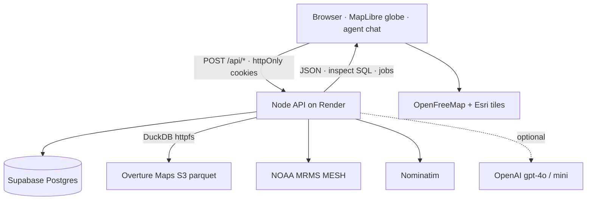

# ReadyHex

Hex-scale building, place, and address intelligence. Ask an agent in English; it finds H3 cells, processes the public Overture Maps release, and returns a filterable table you can save as a workflow.

Live app: [readyhex.com](https://readyhex.com) · Repo: [github.com/alkarboly/ezhex](https://github.com/alkarboly/ezhex)

## Hackathon submission

AITX & MLOps World Community Hackathon @ Austin Tech Week. One submission per team. Hack Fair is Friday, Oct 30 at 1:00 PM at Antler (800 Brazos St #340). Bring a laptop that can run the demo live; wake [readyhex.com](https://readyhex.com) a minute early (Render free instance sleeps).

| Field | Value |
| --- | --- |
| **Project title** | ReadyHex |
| **Track** | Antler Agents |
| **Repo** | https://github.com/alkarboly/ezhex (public) |
| **Deployed URL** | https://readyhex.com |
| **Demo video** | Record 2–5 min on [Loom](https://www.loom.com/). Paste the share URL here after recording. Shot list is below. |
| **Team** | Ahmed Alkarboly — builder — ahmed.alkarboly@gmail.com — [github.com/alkarboly](https://github.com/alkarboly) |

Solo team (event allows 1–5). Add names here if the roster grows.

### Short write-up

Sales crews, roofers, and neighborhood marketers still hunt places, buildings, and addresses in GIS exports. Public Overture Maps already publishes that truth as parquet on S3, but turning a sentence like “restaurants with phones in North Austin” into processed hexes, a filtered table, and an optional hail or AI column is still a multi-tool job.

ReadyHex helps those field teams — anyone who needs hex-scale building, place, and address records for outreach, after-storm roof work, or corridor canvassing — without writing Spark. An operator talks to an agent. The agent finds resolution-8 hexes (a neighborhood, a road corridor, or the area between two places), processes missing cells from the public Overture release into Supabase, builds inspect SQL over all rows, and can attach a geofence, NOAA MRMS hail history, or a typed AI column. Approve & run saves a private workflow, quotes a simulated ledger, and returns a map-backed table plus CSV. Saved workflows use the same Quote & run path.

The impact is English to a downloadable result in minutes, on a live globe, with provenance from Overture, OSM, NAD, and NOAA. Next: real Rho card debit, scheduled subscribe, and persisted ingest jobs.

### Demo video (Loom, 2–5 min)

Show the **core loop live**, not slides. Record on Loom. Suggested shots:

1. **0:00** Title: ReadyHex · Antler Agents · readyhex.com.
2. **0:15** Problem in one sentence, then the globe landing on Austin.
3. **0:40** Open the agent (Ctrl/⌘ K). Run: *Help me find restaurants with contact information in North Austin*.
4. **1:10** Confirm hexes on the map (add/remove a cell). Watch Process jobs, then the query.
5. **2:30** Inspect table, phones/emails, CSV. Mention **Save to agent** if you edit filters.
6. **3:20** **Approve & run**. Show the quote, ledger debit on `/ledger`, and the saved workflow on `/workflows`.
7. **4:00** Optional: hail or AI column in one sentence. Architecture one-liner. Known limits. Stop by 5:00.

Do not record secrets, `.env`, or the Rho staging VPN.

## Quick start

Node **22.16.0**. Python 3.11 only if you run the Weather (hail) add-on.

```bash
git clone https://github.com/alkarboly/ezhex.git
cd ezhex
cp .env.example .env
npm install
npm run dev
```

Open http://localhost:5173. `dev` starts the Node server, which also serves the app.

Fastest local path (Austin generator, no cloud keys):

```bash
DATA_MODE=mock npm run dev
```

PowerShell: `$env:DATA_MODE='mock'; npm run dev`

```bash
npm run verify
npm run build
npm start
```

`verify` checks H3 polygons and mock filters. `build` typechecks and writes `dist/` plus `dist-server/`. `start` serves the production build.

Hail decode needs `pip install -r pipelines/hail/requirements.txt`. Render installs the same file.

## Reproduce the demo

Two ways. Hack Fair: use the deployed URL, then fall back to local if the free instance is slow to wake.

### 1. Live (recommended)

1. Open [readyhex.com](https://readyhex.com). Wait through the globe flight (or skip if `prefers-reduced-motion`).
2. Open the agent (bottom-left bubble, or Ctrl/⌘ K).
3. Click the first example, or type: `Help me find restaurants with contact information in North Austin`.
4. Confirm hexes. Process runs one Overture job per missing cell. Inspect opens on **All rows**.
5. **Approve & run** saves a workflow and debits the simulated ledger. Sign in under Settings if save asks for an account.
6. Optional second pass: the hail example, or **Quote & run** on `/workflows`.

### 2. Local with real Overture

Copy `.env.example` to `.env`. Fill at least:

```
DATA_MODE=supabase
OVERTURE_RELEASE=2026-10-21.0
SUPABASE_URL=https://YOUR_PROJECT.supabase.co
SUPABASE_ANON_KEY=YOUR_ANON_KEY
```

Optional for the planner and AI column:

```
OPENAI_API_KEY=sk-...
OPENAI_AGENT_MODEL=gpt-4o
OPENAI_MODEL=gpt-4o-mini
```

Without an OpenAI key the agent uses built-in heuristics. Nominatim is public (`AGENT_GEOCODER_URL` defaults to `https://nominatim.openstreetmap.org/search`). Do not put a Supabase service-role key, Rho token, or card PAN in `.env`, the repo, or Render.

Run the SQL files in `supabase/migrations/` in filename order (see [supabase/README.md](supabase/README.md)). Include `20261028_agentic_ledger.sql` and `20261029_query_workflow_subscribe.sql`. In Supabase Auth, turn off Confirm email if create-account should start a session immediately.

`VITE_SUPABASE_URL` and `VITE_SUPABASE_ANON_KEY` still work as aliases. The browser never receives those keys; Node holds them and sets httpOnly `wp_access` / `wp_refresh` cookies.

Full env catalog: [.env.example](.env.example). Caps, ledger cents, and geocoder switches live there.

## Tech stack and architecture

| Layer | Stack |
| --- | --- |
| Client | React 19, Vite, MapLibre globe, H3, Zustand, TanStack Query |
| API | Node 22, TypeScript. Query whitelist, DuckDB ingest, agent planner, workflow runs |
| Data | Supabase Postgres (Overture features, snapshots, query workflows, optional auth) |
| Ingest | DuckDB `httpfs` + `spatial` against public Overture S3 parquet |
| Agent | gpt-4o plan (optional), Nominatim regions, specialist jobs on the workflow run |
| Add-ons | Geofence polygon, NOAA MRMS MESH hail (Python), OpenAI `ai_column` |
| Spend | Simulated in-app ledger. Real Rho card debit is not wired |
| Host | Render web service `worldpulse-kb6e` at readyhex.com |



Core agent loop:

```
prompt
  → POST /api/agent/plan          find hexes
  → confirm on the map
  → POST /api/workflow-ingestion/jobs   one job per missing hex
  → POST /api/agent/query         inspect SQL, All rows
  → review add-ons (geofence / hail / ai_column)
  → POST /api/query-workflows + /run    quote, ledger debit, results
```

The browser does not import Supabase or dataset files. Counts, filters, and ingest run on Node. Full request map, agent steps, map layers, and deploy notes: [docs/architecture.md](docs/architecture.md).

## Datasets and provenance

| Data | Use | Provenance |
| --- | --- | --- |
| Overture Maps `2026-10-21.0` (default) | Places, buildings, addresses per hex | Public S3 `s3://overturemaps-us-west-2/release/<version>/`. [Overture attribution](https://docs.overturemaps.org/attribution/) |
| Places | POIs, contacts, categories | CDLA Permissive 2.0; Foursquare rows Apache 2.0 |
| Buildings | Footprints, class, height | ODbL (OSM, Microsoft footprints, others) |
| Addresses | Point addresses | Mixed open licenses; US/Texas from the [National Address Database](https://www.transportation.gov/mission/open/gis/national-address-database/national-address-database-nad-disclaimer). NAD is not a mailing list |
| NOAA MRMS `MESH_Max_1440min` 12Z | Hail size (mm) per hex-day | Public NOAA S3, anonymous. From 2020-11-01. GRIBs stay in temp space |
| OpenStreetMap / OpenFreeMap | Streets basemap | ODbL. Credit on `/licenses` |
| Esri World Imagery | Satellite basemap | Esri terms |
| Nominatim | Agent place / corridor geocoding | OSM geocoder |
| Mock Austin generator | `DATA_MODE=mock` and `npm run verify` only | Synthetic places/buildings/addresses from `src/services/mock/database.ts`. Not production data |

Public notices: [readyhex.com/licenses](https://readyhex.com/licenses).

## Known limitations and next steps

- Ingest jobs live in the Node process. A restart drops the in-memory job store; the agent recreates a missing hex job. Those records are not persisted to Supabase yet.
- The older `workflows*` tables stay the connected ingest scaffold. Product workflows are `query_workflows` (5 per account, up to 300 hexes).
- Subscribe checks snapshots when turned on. There is no scheduler.
- Real Rho card debit is not wired. Quotes, specialist lines, and tips write a simulated ledger (`/ledger`). Rho staging remains the pickup contract in [docs/marketplace.md](docs/marketplace.md).
- OpenAI is optional. Without a key the planner uses heuristics. `ai_column` needs a key.
- Render free instance (512MB) sleeps when idle. Ingest caps stay 8,000 rows per theme / 20,000 total. Hail needs Python 3.11 on the service.
- Cookie names stay `wp_access` / `wp_refresh` from the WorldPulse rename.
- Building names and heights are often empty in Overture. NAD addresses are not for mailing lists.

**Next:** persist ingest jobs, schedule subscribe, wire Rho staging debit if the token can write, keep OpenAI server-side.

## Data mode

| Variable | Purpose |
| --- | --- |
| `DATA_MODE` | `supabase` (default) or `mock` for local verify |
| `SUPABASE_URL` | Project URL, used only when mode is `supabase` |
| `SUPABASE_ANON_KEY` | Publishable anon key, read only by the server |
| `OVERTURE_RELEASE` | Public Overture release id. Default `2026-10-21.0` |

Copy `.env.example` to `.env`. The `VITE_` names of those three variables still work as aliases. Do not put the Supabase service-role key in this app or on Render.

`supabase` mode reads Overture rows from Supabase. Process downloads the public `2026-10-21.0` release for the selected hexes. The active mode is shown in the sidebar, or in the menu on phones. It comes from `GET /api/source`.

## Deploy

Production is [readyhex.com](https://readyhex.com) on Render service **`worldpulse-kb6e`**. `render.yaml` keeps `name: worldpulse` so a blueprint sync updates that service. Do not rename it to `readyhex` and do not click Deploy to Render again. Leave `worldpulse-kb6e` running. Point `readyhex.com` at `worldpulse-kb6e`.

Render runs a Node web service. `render.yaml` builds `main` with Node 22.16.0 using `build:web` at a 384MB heap, then starts `NODE_OPTIONS=--max-old-space-size=256 node dist-server/index.js`. Do not set `NODE_OPTIONS` in the dashboard or the Vite build will OOM. It sets `DATA_MODE=supabase` and the 8,000 / 20,000 ingest caps. The install uses `npm ci --include=dev` so TypeScript and Vite are present when `NODE_ENV` is `production`. Preview instances are off.

Pushes to `main` deploy `worldpulse-kb6e` on their own. A manual deploy is Dashboard → `worldpulse-kb6e` → Manual Deploy. Do not add the Supabase service-role key. The free instance sleeps when idle and wakes on the next request.

## Docs

- [docs/README.md](docs/README.md)
- [docs/architecture.md](docs/architecture.md)
- [docs/query-spec.md](docs/query-spec.md)
- [docs/workflow-pipeline.md](docs/workflow-pipeline.md)
- [docs/marketplace.md](docs/marketplace.md)
- [supabase/README.md](supabase/README.md)
